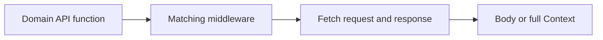

`@momots/drive` is an HTTP client built on Fetch. Requests and responses retain Fetch types such as `Headers`,
`Response`, `AbortSignal`, and `ReadableStream`. Rules shared across endpoints—authentication, logging, and error conversion—
become path-scoped middleware on the client instead of repeated code in every API function.

## What it solves

As endpoints multiply, the surrounding rules become harder to maintain: which endpoints need tokens, which
responses need auditing, which rules belong to each domain, and when callers need status codes or streams.

Drive separates these rules from endpoint functions:

- **Endpoint functions**: specify the URL, data channel, and expected result;
- **Clients**: use middleware to select authentication, logging, error handling, or repeated sending for requests.

This documentation calls a group of requests sharing transport rules a “service boundary.” A domain name, backend service, or set of
authentication rules can each define such a boundary.

Drive fits applications with multiple endpoints or business domains. For a few unrelated requests,
native `fetch` is often clearer.

## Design approach

Using Drive involves three choices.

### 1. Make the data destination explicit

Object-style calls use three fields to distinguish request-data destinations:

| Field | Purpose | Accepted values |
| --- | --- | --- |
| `query` | Add URL query parameters | `URLSearchParams` |
| `json` | Send JSON | Any value the current stringifier can serialize into a string |
| `body` | Use a native Fetch body | `BodyInit \| null` |

`json` and `body` cannot coexist. `query` changes only the URL and creates no body; existing URL query
parameters and fragments are retained, but fragments are not sent in HTTP requests.

Object-style requests, `request()`, and `exec()` also accept `data`. Positional shortcut calls
such as `get(api, data, init)` simply map the second argument to the same automatic channel:

- `URLSearchParams` becomes query parameters;
- Plain objects and arrays become JSON;
- Supported native body objects pass through to Fetch.

Both forms have the same capabilities. Object style names the destination explicitly; positional style is shorter and suits calls whose meaning is immediately
clear. `data` and explicit fields cannot target the same channel: passing `json` together with plain-object `data`, for example,
rejects with `TypeError` before sending.

### 2. Choose the result you need

| Entry point | Purpose | Return value |
| --- | --- | --- |
| Shortcuts such as `get` and `post` | Only the parsed response body matters | `Promise<T>` |
| `exec` | A custom HTTP method, still returning only the body | `Promise<T>` |
| `request` | Status, headers, raw response, or response stream | `Promise<DriveFetchedContext<T>>` |

The generic `T` on shortcuts and `exec()` is a caller assumption about the response format; Drive does not validate it at runtime. Use `void` for a known empty
response and `T | undefined` when a body may be absent. To inspect this yourself, use
`request()`, whose `res.body` is always optional. The default response parser chooses its behavior from response headers
and content, independently of `T`.

### 3. Put shared rules in middleware

Middleware selects requests by path or predicate and executes as an onion: code before `await next()`
handles the request, while code after it handles the response.



Drive does not treat `4xx` or `5xx` as exceptions, cache requests, or resend them by default. Protocols and domains define
failure differently; these rules can live in middleware or `repeat`, or in higher-level tools such as TanStack Query
and Effect.

## Getting started

### Installation

The current version is alpha:

```bash
bun add @momots/drive@alpha @momots/core@alpha remeda
```

`@momots/core` and `remeda` are peer dependencies and must be installed by the application.

Drive targets runtimes with modern Fetch and Stream APIs, primarily Bun, modern browsers, and modern
Node.js. Applications must supply compatibility layers for missing Web APIs.

Drive has no `baseURL` and does not resolve relative addresses itself. Browsers can usually send
`/api/...` using the current origin; Bun and Node.js generally require absolute URLs. The examples below assume a same-origin browser environment,
and undefined identifiers such as `getToken()` represent application dependencies.

### Create a client

Create one Drive instance per service boundary, then export API functions organized by domain.

```ts
import { Drive } from "@momots/drive";

export const drive = new Drive().use("/api/**", async (context, next) => {
  context.req.headers.set("Authorization", `Bearer ${getToken()}`);
  await next();
});

type User = { id: string; name: string };

export const UserApi = {
  list: (page: number) =>
    drive.get<User[]>({
      api: "/api/users",
      query: new URLSearchParams({ page: String(page) }),
    }),
  create: (name: string) =>
    drive.post<User>({ api: "/api/users", json: { name } }),
  remove: (id: string) =>
    drive.delete<void>({ api: `/api/users/${id}` }),
};
```

Pages and business logic call only `UserApi`; tokens, logging, and error handling belong in `drive` middleware.

### Use `request()` when you need metadata

```ts
async function findUser(id: string): Promise<User | undefined> {
  const context = await drive.request<User>({
    api: `/api/users/${id}`,
    method: "GET",
  });

  if (context.res.status === 404) return undefined;
  if (context.res.status >= 400) {
    throw new Error(`HTTP ${context.res.status}`);
  }
  return context.res.body;
}
```

When `request()` succeeds, `raw`, `status`, and `headers` always exist; whether the parser produces a body
depends on the response content and parsing strategy.

## Drive's responsibilities

Drive handles:

- Organizing Fetch request parameters and response metadata;
- Parsing common JSON, text, and attachment responses;
- Combining middleware by path or predicate;
- Providing stream progress and `repeat` sending when explicitly requested.

Drive does not handle:

- Inferring backend models or validating the generic `T`;
- Automatically converting HTTP status codes to domain exceptions;
- Automatically deciding whether a write request is safe to replay;
- Replacing caching, server-state, or UI loading-state tools.

## Where to go next

| Question | Read |
| --- | --- |
| Why middleware, Context, and explicit data channels? | [Philosophy](/docs/drive/philosophy) |
| How do I build a working client? | [Tutorial](/docs/drive/tutorial) |
| How do I handle common tasks? | [Examples](/docs/drive/examples) |
| How do I add CSRF tokens to cookie-session requests? | [Recipes: CSRF](/docs/drive/recipes#csrf) |
| What exactly does a field, overload, or type mean? | [API reference](/docs/drive/guide) |
